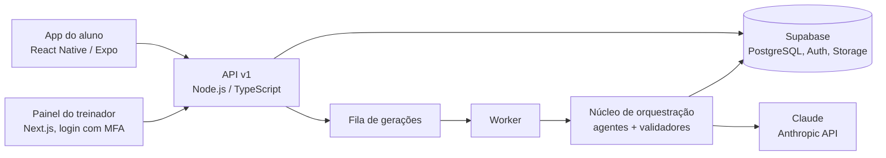
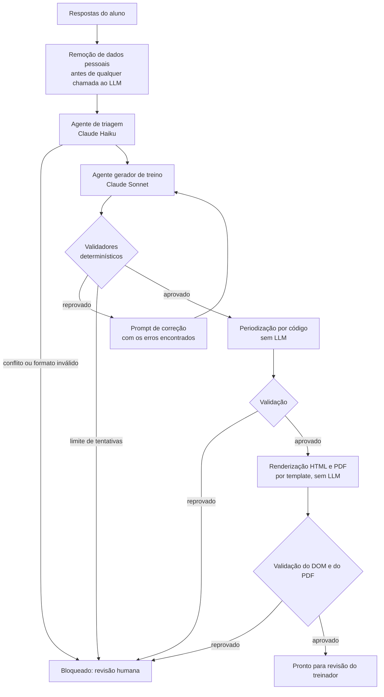

# TRAINING (ex-Battallion): geração de programas de treino com LLMs

> **English summary.** Production platform where a strength coach generates personalized training
> programs with LLM agents (Claude, via the Anthropic API). Two specialized agents run inside a
> validated state machine: deterministic validators check every model output, failed outputs go
> through a bounded correction loop, and nothing reaches a student without the coach's review.
> Includes an evaluation harness (pass criteria, token and cost tracking, blind A/B review).
> More than 100 programs generated in real use. **The source code is private; this repository is
> an overview of the architecture and the engineering decisions.**

Este repositório é a visão geral de um produto em uso. O código é privado porque o sistema atende
alunos reais e contém a metodologia do treinador. Posso demonstrar o sistema e percorrer o código
em uma conversa.

## O problema

Montar um programa de treino individual leva tempo do treinador: ler o formulário do aluno, cruzar
objetivo, dias disponíveis, lesões, equipamento e experiência, escolher exercícios dentro da
metodologia, periodizar as semanas e entregar um material apresentável. Feito à mão, isso limita
quantos alunos um treinador consegue atender.

## O que o sistema faz

- O aluno responde um formulário de entrada (link com token).
- O treinador dispara a geração no painel. Uma fila processa o pedido em segundo plano.
- Agentes de LLM fazem a triagem do caso e geram o treino. Validadores determinísticos conferem a
  saída contra as regras da metodologia e contra o que o aluno respondeu.
- A periodização das semanas e o PDF final são montados por código, sem LLM.
- O treinador revisa, ajusta se quiser e atribui. O aluno recebe o programa no app, registra as
  sessões e conversa com o treinador.

**Em uso real: mais de 100 programas de treino gerados.**

## Arquitetura

API e worker rodam como dois processos da mesma imagem Docker no Fly.io (região São Paulo), com
deploy pelo GitHub Actions, erros no Sentry e e-mails transacionais pelo Resend.

## O núcleo de IA

O fluxo de geração é uma máquina de estados com transições explícitas. Cada etapa só avança se a
anterior foi aprovada, e qualquer etapa pode desviar para `BLOQUEADO: precisa de humano`.

Decisões de engenharia que sustentam esse desenho:

- **Um modelo por papel.** Triagem usa um modelo rápido e barato; geração usa um modelo mais
  capaz. Modelo e nível de esforço de cada agente são configuração, não código.
- **O LLM só decide o que exige julgamento.** Plano contratado, níveis do aluno, agenda semanal,
  periodização e layout do PDF saem de regras e de código. Isso reduz custo, elimina uma classe
  inteira de erros e torna a saída reproduzível.
- **Saída estruturada com validação por schema.** Toda resposta do modelo é parseada e validada
  (Zod). Saída fora do schema não quebra o fluxo: vira um erro de validação que alimenta o laço
  de correção.
- **Laço de correção limitado.** O validador devolve os erros para o modelo em um prompt de
  correção. Há um teto de tentativas por etapa; ao estourar, o caso vai para o treinador em vez
  de insistir.
- **Privacidade.** Nome, e-mail e WhatsApp do aluno são removidos antes de o
  texto chegar ao LLM.
- **Falhas classificadas.** Erro de configuração, serviço fora do ar e recusa do modelo têm
  códigos distintos para a fila e para o painel. Respostas longas usam streaming para não
  estourar o tempo limite HTTP.
- **Custo medido.** Cada geração registra número de chamadas e tokens de entrada e saída.
- **Testável sem API.** Um cliente de LLM simulado permite rodar o fluxo completo, do formulário
  ao PDF, nos testes automatizados.

## Avaliação de modelos (evals)

Trocar de modelo ou mexer em prompt sem medir é chute. O repositório tem um harness de avaliação
que roda cada caso pela mesma rota da produção (formulário, triagem, geração, validação, PDF):

- **Casos reais anonimizados.** Respostas de alunos são anonimizadas e conferidas por um script
  antes de qualquer uso (LGPD). Os casos ficam fora do Git.
- **Seleção determinística** para cobrir combinações de plano, dias disponíveis, objetivo, lesão,
  equipamento e experiência.
- **Critério de aprovação por execução:** chegou a "pronto para revisão" dentro do limite de
  tentativas, sem exercício contraindicado, com sessões compatíveis com os dias do aluno e PDF
  válido. Cada propriedade é registrada separadamente.
- **Métricas por execução:** tentativas por etapa, tokens, custo, modelo servido e tempo.
- **Falha de infraestrutura separada de falha de modelo**, para a comparação entre modelos não
  ser contaminada por erro de rede ou timeout.
- **Revisão cega A/B.** Para comparar dois modelos, o treinador avalia PDFs sem saber qual
  modelo gerou cada um; o gabarito fica guardado à parte.

## Números

| | |
|---|---|
| Programas gerados em uso real | 100+ |
| Commits | 240+ |
| Arquivos de teste | 70+ |
| Migrations de banco | 29 |
| Agentes de LLM | 2 (triagem e geração) |

## Stack

TypeScript, Node.js, Anthropic SDK (Claude), Zod, Next.js, React Native / Expo, Supabase
(PostgreSQL, Auth com MFA, Storage), Docker, Fly.io, GitHub Actions, Sentry, Resend.

## Meu papel

Projetei e construí todo o backend: núcleo de orquestração e validação, integração com o LLM,
harness de avaliação, API, fila e worker, banco e deploy. O painel do treinador e o app do aluno
foram desenvolvidos em parceria com um colega.

## Contato

Felipe Nantes · [linkedin.com/in/felipe-nantes-23719b349](https://www.linkedin.com/in/felipe-nantes-23719b349/) ·
[github.com/felipe-nantes](https://github.com/felipe-nantes)
